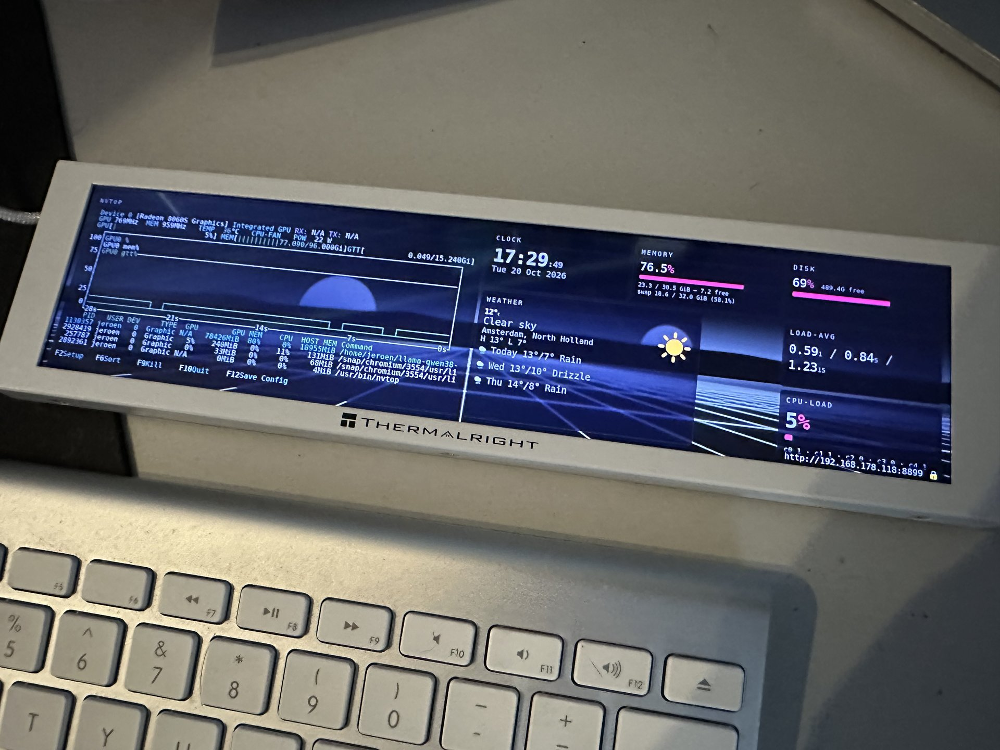
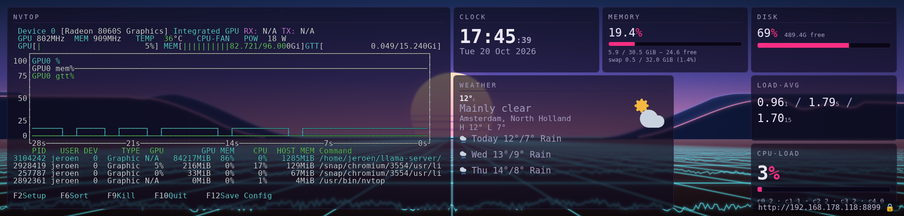
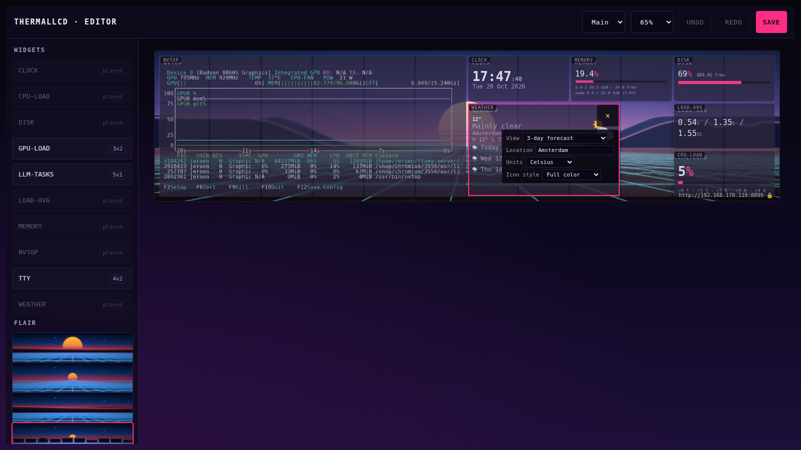

# thermallcd

Open Linux dashboard platform for the [Thermalright Trofeo Vision](https://www.thermalright.com/) 9.16" LCD
system-monitor panel. The vendor ships this display with Windows-only software;
thermallcd drives it from any Linux host: a web dashboard rendered in headless
Chromium, captured over CDP and streamed to the USB display at ~15 FPS.



## Screenshots

The dashboard renders at the panel's native 1920×462 — the capture is
pixel-identical to what the LCD shows. Ten widgets, an animated synthwave
backdrop, and a browser drag-and-drop editor to arrange it all.

| | |
|---|---|
|  |  |
| Dashboard — 1920×462, exactly what the panel shows | Editor — live preview, per-widget options, undo/redo |

## How it works

```
┌──────────────────────┐                        ┌───────────────┐
│ Chromium (headless,  │                        │  thermallcd   │
│ resident)            │──CDP screencast──►     │  capture.py   │
│ renders /dashboard   │   ~15 FPS PNG frames   │  re-encodes   │
└──────────────────────┘                        │  to JPEG      │
                                                └──────┬────────┘
   ┌──────────────────────────────────┐               │ USB
   │  Python stdlib web server        │               ▼
   │  / dashboard · editor · widgets  │        ┌───────────────┐
   │  /api/* · SSE metrics            │        │  lcd.py       │
   └──────────────────────────────────┘        │  0416:5408    │
                                               └───────────────┘
```

- **The dashboard is a web page.** Each widget is a sandboxed iframe that
  subscribes to a shared metrics snapshot over SSE. Rendering happens in the
  browser, so widgets are just HTML/CSS/JS — no plugin API to learn.
- **Widgets are drop-in files.** A widget is a directory with a `manifest.json`
  (name, default size, options) and an `index.html`. Drop it into `widgets/`
  and it appears in the editor palette on the next scan.
- **Configuration is a browser editor.** Open `/editor`, log in with the token
  shown on the panel, and drag widgets around a live preview of the dashboard.
  Layouts, options and flair are stored per panel.

## Features

**Dashboard**
- 10 bundled widgets (see below), sandboxed iframes fed by one metrics snapshot
- Widget pages: multiple layouts per panel that crossfade on a timer
  (`cycle_min`), each page with its own widget set
- Per-device layouts: one server drives multiple panels, each with its own
  arrangement, options and flair
- Animated flair layer behind the widgets: 6 scenes × 6 themes, motion
  direction, glass opacity, spectrum bars driven by system load, stars,
  scanlines — plus a scene-rotation timer for anti-burn-in
- Optional URL watermark on the panel (also serves as the login-token hint)
- Honest empty and stale states — widgets dim and show what's missing instead
  of freezing or faking zeros

**Widgets** (all bundled, all optional)

| Widget | Shows |
|---|---|
| clock | Large clock face with date, sized to its slot |
| cpu-load | Per-core load history graph |
| gpu-load | GPU load/utilization graph |
| nvtop | Live `nvtop` GPU monitor (processes, VRAM, clocks) as an image pane |
| llm-tasks | Ticker of running LLM tasks (llama-swap + `/proc` scan) |
| mem | Memory and swap usage |
| load-avg | Load averages |
| disk-usage | Filesystem usage |
| tty | Terminal sessions streamed to the panel via a pty |
| weather | Open-Meteo current conditions + 3-day forecast, location autocomplete, °C/°F, line-art or full-color icons, scales to fit its slot |

**Editor** (`/editor`)
- Drag-and-drop on a 12×3 grid with corner resize, click-to-select,
  undo/redo, zoom picker
- Per-widget options in a manifest-declared popover (e.g. weather view, units,
  location with geocode autocomplete, icon style) — no config files to edit
- Live preview of the actual dashboard page; saves appear on the panel in
  ~2 seconds
- Placement validation: a drop that doesn't fit is denied with a toast, never
  overlaps silently
- Flair picker with scene thumbnails, themes, motion, glass, spectrum, and
  rotation interval
- Token-gated; "remember on this device" supported

**Operations**
- Single service: `thermallcd.supervisor` runs the web server plus one
  resident headless Chromium per connected panel
- udev rule starts the capture whenever a panel is plugged in
- Token auth on every route; `deploy/reset-token.sh` rotates it
- Test suite: `python3 -m unittest discover tests`

## Manual

### Requirements

- Any Linux host with a spare USB port (tested on Debian)
- Python 3 with `Pillow`, `websocket-client`, `pyusb`, `pyte` (`pip install`)
- Chromium (headless capture path)
- The Trofeo Vision 9.16" panel (USB 0416:5408)

### Install

```sh
git clone https://github.com/wminno/thermallcd.git && cd thermallcd
pip install Pillow websocket-client pyusb pyte   # --user or venv, your call
./deploy/install.sh                              # sudo: udev rule + systemd unit
```

`install.sh` installs the udev rule, fills the systemd unit with your user and
repo path, and enables the service — the dashboard starts on port 8899 when
the panel is plugged in. Check with `systemctl status thermallcd.service`,
logs via `journalctl -u thermallcd.service -f`.

Without a panel you can still develop: `python3 -m thermallcd.dashboard
--data data` serves the dashboard and editor in a normal browser window.

### Login

The server is token-authenticated. On first boot the token is shown on the
panel itself, bottom-right (enable the URL watermark to keep it there).
Log in at `http://<host>:8899/editor`, or use the token as a query parameter
for API calls. Rotate it with:

```sh
./deploy/reset-token.sh <new-token>   # writes data/token, restarts the service
```

### Editing a layout

1. Open `http://<host>:8899/editor` and enter the token.
2. Pick the panel in the device dropdown (multiple panels each keep their own
   layout), pick a zoom, and drag widgets from the palette onto the grid.
   Resize from the corner handles; click a widget to edit its options.
3. Switch between widget **pages** in the sidebar: each page is an independent
   layout; set the page-cycle interval to rotate them on the panel.
4. Configure the flair scene (background), then hit **Save** — the panel
   updates within a couple of seconds.

### Writing a widget

See [`docs/widgets.md`](docs/widgets.md) for the widget contract: a
`manifest.json` (id, title, default grid size, declared options) and an
`index.html` that subscribes to the shared metrics snapshot
(`window.tlcd.onMetrics`). Drop the directory into `widgets/` and it shows up
in the editor palette.

## Hardware

The Trofeo Vision family shares one USB protocol with several panel geometries
keyed on a handshake byte: 1920×462 (this 9.16" SKU), 1920×440, 1280×480 and
320×320. `lcd.py` implements the 0416:5408 pipeline (JPEG frame upload); the
platform resolves each connected panel's geometry at handshake, so multiple
panels of the same class can run side by side.

## Status

Working and in daily use on one panel: driver, capture pipeline (steady 15 FPS
with a `--fps` override), web server, editor, all ten widgets, flair, widget
pages, multi-panel layouts, token auth, and the geocode proxy. Known gaps and
planned work live in the issue tracker.

## Credits

- [trcc-linux](https://github.com/trcc-linux/)'s `ly_lcd.py` — the authoritative
  reference for the vendor's USB protocol (reverse-engineering notes in this
  repo defer to it)
- [GridStack.js](https://gridstackjs.com/) — vendored for the editor grid
- MIT — see [LICENSE](LICENSE)
