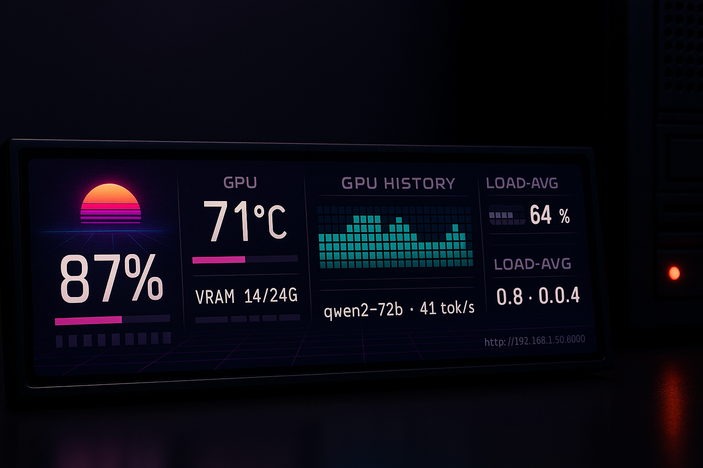
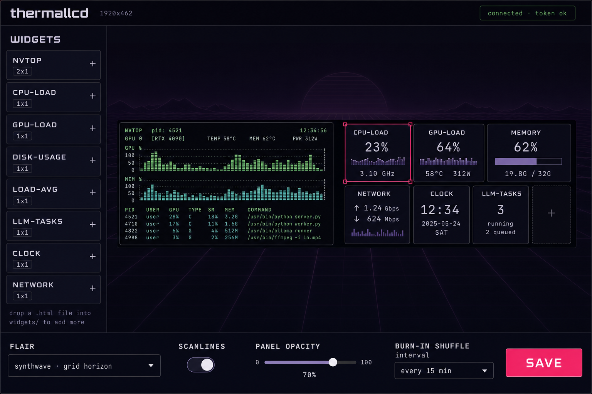

# thermallcd

**The fully open Linux dashboard platform for Thermalright's Trofeo Vision 9.16" panel** —
and for the whole USB LCD class it belongs to (0416:5408, 1920x462).

The vendor ships this panel with Windows-only software. thermallcd turns it into a
live, browser-rendered dashboard for your Linux server: a web page drawn at the panel's
native 1920x462, captured over CDP and streamed to the USB display at ~6 FPS.


*Design preview (AI mockup) — the default layout: CPU/GPU heroes, an nvtop block-matrix
graph, disk + load meters, an LLM-tasks ticker, and the synthwave scene showing through
the empty region. A real panel photo lands with the capture spike.*

## How it works

```
┌─────────────────────────── Linux host ───────────────────────────┐
│  Chromium (headless, resident)  ──CDP screencast──►  capture.py  │
│  dashboard page: widgets as drop-in iframes on a synthwave scene │   at ~6 FPS
│  config editor: drag-drop GridStack, token-protected             │       ▼
│  metrics API: /api/metrics per-tick snapshots                    │  lcd.py (USB 0416:5408)
└──────────────────────────────────────────────────────────────────┘       ▼
                                                                    9.16" panel, 1920x462
```

- **The dashboard is a web page.** Chromium owns the frame clock — animations, fonts,
  canvas scenes and terminal bitmaps all render natively; Python is just the transport.
- **Widgets are drop-in files.** A directory with `manifest.json` + `index.html` in
  `widgets/` is discovered at the next registry scan. Widgets run in isolated iframes
  and consume the platform theme contract (`widgets/theme.css` custom properties).
- **Configuration is a browser editor.** Drag to move, corner-drag to resize in grid
  units, full undo/redo, live WYSIWYG canvas — with multi-page layouts cycling on a
  timer and flair scene rotation against panel burn-in.


*Design preview (AI mockup) — the config editor: live dashboard canvas, widget palette
with size badges, flair/scanline/opacity controls.*

## Widgets (first six)

| Widget | What it shows | Source |
|--------|---------------|--------|
| `nvtop` | GPU utilization block-matrix history (terminal-style) | existing pty/pyte pane, re-rendered |
| `cpu-load` | Per-core utilization + hero percentage | `/api/metrics` |
| `gpu-load` | GPU busy %, VRAM, temperature | `/api/metrics` |
| `disk-usage` | Filesystem usage meter | `/api/metrics` |
| `load-avg` | 1/5/15-minute load averages | `/api/metrics` |
| `llm-tasks` | Running LLM jobs — model, tok/s, context | `/api/metrics` |

## Flair

The synthwave scene is on from first boot: canvas grid-horizon scenes, CRT scanline
overlay, adjustable glass-panel opacity, and a URL watermark (hideable) that carries
the editor address — token auth included. Flair animations are authored against a
captureFps-aware clock (`--tlcd-tick`) so the panel's ~6 FPS shows smooth motion.

## Status

- **Design: reviewed.** `/plan-eng-review` (24 issues → tasks T1-T7) and
  `/plan-design-review` (six passes, 4/10 → 9/10, 22 recorded decisions) both complete;
  the full design lives at [`docs/designs/dashboard-platform.md`](docs/designs/dashboard-platform.md).
- **Driver: working.** `thermallcd/lcd.py` (USB 0416:5408, 1920x462 JPEG pipeline) and
  `thermallcd/nvtop_pane.py` (pty/pyte renderer with a force-repaint mitigation for
  ncurses drift) are installed and running as a systemd service.
- **Platform: next.** Capture spike — resident headless Chromium + `Page.startScreencast`
  → lcd.py — is the next milestone, followed by the web server, editor, widgets and flair
  (tasks T1-T16 in the design doc).

## Hardware

- Thermalright Trofeo Vision 9.16" LCD (USB 0416:5408, 1920x462) — the vendor family is
  multi-mode (1920x462 / 1920x440 / 1280x480 / 320x320, keyed on the handshake byte);
  thermallcd resolves a per-device profile at handshake and supports multiple panels.
- Any Linux host with a spare USB port; Chromium for the capture path; Python 3 with
  pyusb + Pillow (+ pyte for the nvtop pane).

## Install (driver, today)

```bash
git clone https://github.com/wminno/thermallcd.git && cd thermallcd
./deploy/install.sh          # deps + udev rule + systemd unit (edit the template vars)
sudo systemctl start thermallcd.service
```

Reset the dashboard access token with `./deploy/reset-token.sh <new-token>`
(writes `data/token`, restarts the service; URL-safe characters only).

The dashboard platform (web server, editor, widgets) lands with the capture spike.

## Contributing widgets

Until `docs/widgets.md` publishes with the first platform milestone: a widget is a
directory under `widgets/` with `manifest.json` (name, size in grid units, resize mode)
and `index.html` that renders from `/api/metrics`. Theme via the provided CSS custom
properties; keep animation cycles ≤0.5 Hz so the 6 FPS capture samples cleanly.

## Credits & license

Panel protocol documented from study of the GPL-licensed `trcc-linux` reference
driver (`ly_lcd.py` — the authoritative source for the 0416:5408 handshake and
frame protocol). Code is MIT — see [LICENSE](LICENSE).
